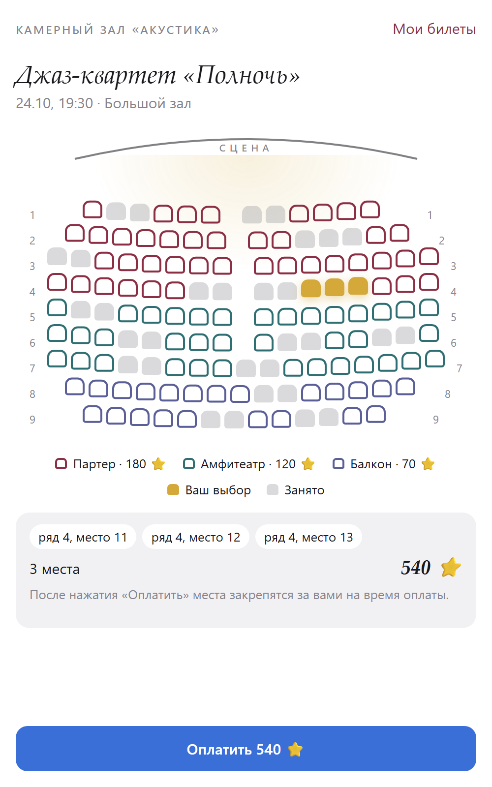

# Telegram Seat Booking

Бронирование мест со схемой зала внутри Telegram. Зритель открывает мини-приложение, выбирает сеанс и кресла на схеме, платит звёздами Telegram, не выходя из неё, и получает в чат билеты с QR-кодами. Контролёр на входе сканирует QR камерой телефона в том же мини-приложении. Одно место нельзя продать дважды: его занимает один атомарный `UPDATE`, а тест гоняет трёх зрителей за одни и те же кресла.

[](LICENSE)
[](https://github.com/tgKishikaisei/telegram-seat-booking/actions/workflows/ci.yml)



Снимок сделан на локальном стенде с демо-афишей из `bot/content/venue.json`; синяя кнопка внизу заменяет нативную кнопку Telegram.

## Как работает

```
Mini App: афиша → схема зала → выбор до 6 мест → «Оплатить N ⭐» (нативная кнопка Telegram)
   │ POST /api/shows/{id}/hold — места закрепляются за зрителем на 10 минут (атомарный UPDATE)
   │ POST /api/holds/{id}/invoice — счёт (createInvoiceLink) → Telegram.WebApp.openInvoice
   ▼
Бот: pre_checkout (проверка + продление брони на время оплаты) → successful_payment → билеты с QR в чат
     если места потеряны посреди оплаты — звёзды возвращаются автоматически
Вход: «Проверка билетов» → сканер QR → отметка «прошёл» (повторно не пропустит)
```

Зал и афиша описаны в одном файле `bot/content/venue.json`: ряд — это строка, буква — ценовая зона, `_` — проход. Бот при старте сверяет файл с базой и создаёт сеансы с местами.

## Структура

```
telegram-seat-booking/
├── bot/
│   ├── app.py                ← процесс бота: афиша → кнопка меню → оплата → билеты → фоновые задачи
│   ├── web/                  ← процесс веб-части (python -m bot.web)
│   │   ├── app.py · api.py   ← FastAPI: проверка initData, брони, счета, контроль на входе
│   │   └── static/           ← мини-приложение: index.html, app.css, app.js (без сборщиков)
│   ├── content/venue.json    ← зал и афиша
│   ├── models/booking.py     ← shows, show_seats, holds, orders, tickets
│   ├── repositories/         ← атомарные переходы статусов мест и заказов
│   ├── services/             ← venue, booking (бронь), payments, tickets (QR + HMAC)
│   ├── handlers/ · gateways/ticket_sender.py · jobs/booking.py
│   └── core/                 ← общая инфраструктура: настройки, БД, Redis, лимиты, логи, проверка initData
├── migrations/               ← Alembic
├── deploy/                   ← Caddy (HTTPS), роли PostgreSQL, Redis
├── tests/                    ← 44 теста, включая API через TestClient и гонку за места
└── docker-compose.yml        ← PostgreSQL, Redis, migrate, bot, web, caddy
```

## Защита

| Угроза | Защита |
|---|---|
| Поддельный пользователь в API | каждый запрос подписан initData Telegram (HMAC от токена бота), срок жизни ограничен |
| Двойная продажа места | `UPDATE … WHERE status='free' OR бронь истекла`; не хватило хотя бы одного места — откат всей брони |
| Чужая бронь / счёт | бронь по случайному ID и проверка владельца; кто держит места — другим не раскрывается |
| Подмена суммы | сумма только из БД; payload счёта подписан HMAC; pre_checkout сверяет всё |
| Деньги без мест | бронь продлевается на время оплаты; если места всё же потеряны — автовозврат звёзд |
| Поддельный или повторный билет | случайный код + HMAC в QR; отметка входа атомарная |
| Лишние поля / XSS | `extra="forbid"` в запросах; во фронтенде только `textContent`; CSP без inline-скриптов |
| Флуд | лимиты запросов и броней на пользователя (Redis) |

Подробнее — в [SECURITY.md](SECURITY.md).

## Стек

Python 3.12, aiogram 3, FastAPI, SQLAlchemy 2 (async), Alembic, PostgreSQL, Redis, Telegram Mini Apps и Telegram Stars, Docker Compose, Caddy.

## Запуск

```bash
git clone https://github.com/tgKishikaisei/telegram-seat-booking.git
cd telegram-seat-booking
python -m venv .venv
.venv\Scripts\activate              # Linux и macOS: source .venv/bin/activate
pip install -r requirements.txt
cp .env.example .env                # BOT_TOKEN, TICKET_SECRET, PUBLIC_URL (https!), ADMIN_IDS, STAFF_IDS
python -m bot                       # бот
python -m bot.web                   # веб-часть на :8000
```

Локально хватает SQLite и памяти процесса: без `REDIS_URL` лимиты и состояния живут в памяти. Telegram открывает мини-приложения только по HTTPS, поэтому для `PUBLIC_URL` нужен домен или туннель.

**Продакшен.** Положите секреты в `secrets/` (как — в [secrets/README.md](secrets/README.md)), укажите `DOMAIN` и `ACME_EMAIL` в `.env` и запустите `docker compose up -d --build`. Caddy сам получит сертификат, схему базы создаст `alembic upgrade head` в сервисе `migrate`.

## Тесты

```bash
pip install -r requirements-dev.txt
python -m pytest -q
```

Покрыты: схема зала и ошибки в ней, синхронизация афиши, правила брони, скрытие чужих броней, гонка трёх зрителей за одни места (на файловой базе), оплата со всеми отказами `pre_checkout` и идемпотентностью, автовозврат, вход по билету (рано, подделка, повтор), возврат заказа, API целиком через TestClient.

Сборка Docker-образа проверяется в CI. Вживую с Telegram и боевыми платежами проект не обкатывался.
